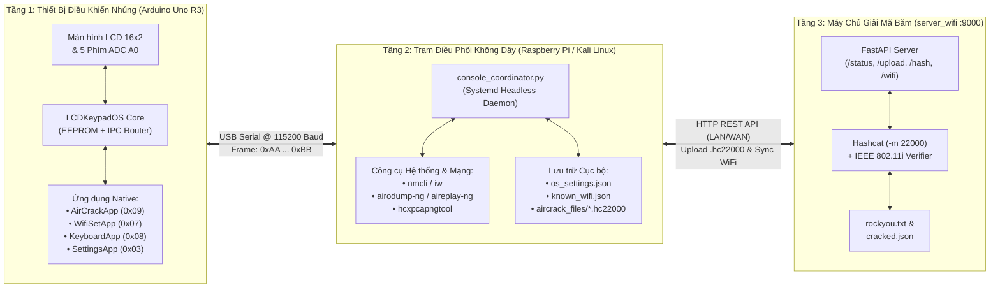

<div align="center">

# ⚡ ACNG — Embedded Arduino LCD OS & Wireless Security Suite

**Hệ Điều Hành Nhúng Module Hóa Trên Arduino Uno R3 (LCD 16x2 Keypad Shield), Trạm Điều Phối Raspberry Pi (Kali Linux) & Máy Chủ Giải Mã WPA/WPA2 (`server_wifi`)**

[](#3-yêu-cầu-phần-cứng--sơ-đồ-kết-nối)
[-00599C?style=for-the-badge&logo=cplusplus&logoColor=white)](#4-hệ-sinh-thái-ứng-dụng-trên-arduino-lcd-os)
[](#6-hướng-dẫn-cài-đặt--triển-khai-nhanh)
[](#63-cài-đặt-máy-chủ-giải-mã-server_wifi--hashcat)
[](#7-giao-thức-nhị-phân-115200-baud-binary-protocol)
[](#-tuyên-bố-miễn-trừ-trách-nhiệm-disclaimer)

</div>

---

## 📖 Mục Lục

1. [Giới Thiệu Tổng Quan](#1-giới-thiệu-tổng-quan)
2. [Kiến Trúc Hệ Thống 3 Tầng](#2-kiến-trúc-hệ-thống-3-tầng)
3. [Yêu Cầu Phần Cứng & Sơ Đồ Kết Nối](#3-yêu-cầu-phần-cứng--sơ-đồ-kết-nối)
4. [Hệ Sinh Thái Ứng Dụng Trên Arduino LCD OS](#4-hệ-sinh-thái-ứng-dụng-trên-arduino-lcd-os)
5. [Cấu Trúc Repository](#5-cấu-trúc-repository)
6. [Hướng Dẫn Cài Đặt & Triển Khai Nhanh](#6-hướng-dẫn-cài-đặt--triển-khai-nhanh)
7. [Giao Thức Nhị Phân 115200 Baud (Binary Protocol)](#7-giao-thức-nhị-phân-115200-baud-binary-protocol)
8. [Tài Liệu Kỹ Thuật Chuyên Sâu](#8-tài-liệu-kỹ-thuật-chuyên-sâu)
9. [Tuyên Bố Miễn Trừ Trách Nhiệm (Disclaimer)](#-tuyên-bố-miễn-trừ-trách-nhiệm-disclaimer)
10. [Tác Giả & Lời Cảm Ơn (Credits & Acknowledgments)](#-tác-giả--lời-cảm-ơn-credits--acknowledgments)

---

## 1. Giới Thiệu Tổng Quan

**ACNG** là một nền tảng phần cứng – phần mềm tích hợp (Hybrid Embedded Operating System), biến bo mạch **Arduino Uno R3 + DFRobot LCD 16x2 Keypad Shield** kết hợp cùng **Raspberry Pi (Kali Linux)** thành một thiết bị điều khiển mạng không dây và kiểm thử bảo mật WPA/WPA2 độc lập (**Headless Embedded Node** — không cần màn hình HDMI, chuột hay bàn phím rời).

### ✨ Điểm Nổi Bật Kỹ Thuật
- **Kiến trúc OS siêu nhẹ trên ATmega328P**: Vận hành mượt mà nhiều ứng dụng độc lập, bàn phím ảo 16x2, đồng bộ cấu hình EEPROM + JSON và giao tiếp liên ứng dụng (`Inter-App IPC`) chỉ với **~60% bộ nhớ SRAM** (`~805 Bytes` RAM trống an toàn).
- **Giao thức nhị phân 115200 Baud chống nhiễu**: Đóng gói khung tin `0xAA [LEN] [CMD] [PAYLOAD] [XOR_CRC] 0xBB` với độ trễ khứ hồi (Ping RTT) chỉ **3.6ms – 7.6ms** và cơ chế phân trang theo chỉ số (`Paginated Item Fetching`) không bao giờ làm tràn bộ đệm UART 64-byte.
- **Quy trình kiểm thử WPA/WPA2 khép kín (End-to-End Workflow)**: Từ quét AP, chuyển chế độ `Monitor`, bắt gói bắt tay `EAPOL Handshake`, bắn gói `Deauth`, chuyển đổi `.cap` sang `.hc22000` cho tới gửi lên máy chủ GPU giải mã (`server_wifi`) và lưu mật khẩu thẳng vào `Known WiFi` — tất cả thao tác trực tiếp bằng 5 nút bấm trên màn hình LCD 16x2.
- **Kết nối WiFi & Quản lý cấu hình thông minh**: Tự động nhận diện các mạng đã có trong `Known WiFi` để kết nối một chạm không cần nhập lại mật khẩu; hỗ trợ chỉnh sửa trực tiếp `Server IP` trên bàn phím ảo và tự động khôi phục IP mặc định khi để trống.

---

## 2. Kiến Trúc Hệ Thống 3 Tầng



---

## 3. Yêu Cầu Phần Cứng & Sơ Đồ Kết Nối

| Thành phần | Thiết bị khuyến nghị | Vai trò trong hệ thống |
| :--- | :--- | :--- |
| **Vi điều khiển & UI** | **Arduino Uno R3** (ATmega328P) + **DFRobot LCD 16x2 Keypad Shield** | Hiển thị giao diện người dùng 16x2, đọc 5 phím bấm qua cầu phân áp `A0`, lưu cấu hình dự phòng EEPROM. |
| **Máy tính nhúng** | **Raspberry Pi 3B / 4 / 5** (Chạy Kali Linux hoặc Raspberry Pi OS) | Chạy dịch vụ `arduino-coordinator.service`, điều khiển các card mạng không dây và công cụ bảo mật. |
| **Card WiFi 1 (Onboard)** | `wlan0` (Broadcom tích hợp trên Pi) | Kết nối WiFi thường ngày (`Managed Mode`), đồng bộ dữ liệu mạng. |
| **Card WiFi 2 (USB rời)** | `wlan1` (VD: TP-Link TL-WN722N / chipset Atheros, Realtek hỗ trợ Monitor) | Chuyển sang `Monitor Mode`, quét AP, bắt gói `EAPOL Handshake` và thực thi `Deauth`. |
| **Máy chủ giải mã** | PC / Server chạy Windows hoặc Linux (hỗ trợ GPU/CPU) | Chạy `server_wifi/main.py` kết hợp `hashcat` để giải mã nhanh các file `.hc22000`. |

---

## 4. Hệ Sinh Thái Ứng Dụng Trên Arduino LCD OS

### 4.1. Các ứng dụng cốt lõi nạp mặc định (`ArduinoLCDOS.ino`)

| App ID | Tên trên LCD | Module Nguồn | Tính năng chi tiết |
| :---: | :--- | :--- | :--- |
| `0x09` | **`AirCrack`** | [`AirCrackApp`](arduino/ArduinoLCDOS/src/apps/AirCrackApp) | • Chọn card mạng (`wlan0`, `wlan1`...) và chuyển đổi `Managed` / `Monitor`.<br>• **Scan APs & Select Target**: Quét AP thực tế (SSID/BSSID, kênh, cường độ sóng).<br>• **Capture HS & Deauth**: Bắt gói bắt tay WPA2 bằng `airodump-ng` và bắn gói `aireplay-ng --deauth`.<br>• **Cap->HC22000**: Chuyển đổi file `.cap` sang `.hc22000` qua `hcxpcapngtool`.<br>• **Send Hash / DL Cracked / Server Status**: Gửi file `.hc22000` lên `server_wifi` để giải mã, hiển thị `PW:<mật_khẩu>` ngay trên LCD và tự lưu vào `Known WiFi`.<br>• **Server IP**: Chỉnh sửa trực tiếp IP hiện có trên bàn phím ảo; nếu xóa trống tự động đặt về IP mặc định (`169.254.84.122`). |
| `0x07` | **`WiFi Set`** | [`WifiSetApp`](arduino/ArduinoLCDOS/src/apps/WifiSetApp) | • Quản lý chế độ từng card mạng (`Managed` / `Monitor` / `AP`).<br>• **Scan WiFi**: Quét các mạng xung quanh và đánh dấu `*` cho mạng đã lưu.<br>• **Kết nối 1 chạm**: Mạng đã có trong `Known WiFi` sẽ kết nối ngay bằng mật khẩu đã lưu mà không cần nhập lại; mạng mới sẽ tự động mở `Keyboard` để nhập mật khẩu.<br>• **Known WiFi**: Duyệt danh sách WiFi đã biết và bấm `SELECT` để kết nối nhanh. |
| `0x08` | **`Keyboard`** | [`KeyboardApp`](arduino/ArduinoLCDOS/src/apps/KeyboardApp) | • Bàn phím ảo trên màn hình 16x2 với 4 bộ ký tự (`abc`, `ABC`, `123`, `SYM`).<br>• Hỗ trợ điền sẵn giá trị cũ (pre-fill) khi sửa `Server IP` và tự động quay về ứng dụng gọi sau khi bấm `OK` hoặc `X`. |
| `0x03` | **`Cai Dat (Set)`** | [`SettingsApp`](arduino/ArduinoLCDOS/src/apps/SettingsApp) | • Bật/tắt đèn nền LCD (`Backlight`) và âm thanh (`Sound`).<br>• Xem thông số phần cứng thời gian thực (`Free RAM`, `Uptime`, `Baudrate`).<br>• **Reset AllData**: Khôi phục cài đặt gốc toàn bộ EEPROM & `os_settings.json` với máy trạng thái xác nhận 2 bước an toàn. |

### 4.2. Các module ứng dụng mở rộng có sẵn trong `src/apps/`
Ngoài 4 ứng dụng chính trên, kho mã nguồn còn cung cấp sẵn các module ứng dụng độc lập có thể đăng ký thêm vào `ArduinoLCDOS.ino` bất cứ lúc nào:
- [`NativeGameApp`](arduino/ArduinoLCDOS/src/apps/NativeGameApp) (`0x01`): Trò chơi "Dungeon Runner" chạy 100% offline trên Arduino Uno, tự lưu điểm kỷ lục `High Score`.
- [`PyBridgeApp`](arduino/ArduinoLCDOS/src/apps/PyBridgeApp) (`0x02`): Ứng dụng `PC test` kiểm thử cầu nối hai chiều tự động bật/tắt cửa sổ GUI trên máy tính.
- [`CounterApp`](arduino/ArduinoLCDOS/src/apps/CounterApp) (`0x04`): Bộ đếm sự kiện đồng bộ EEPROM + JSON thời gian thực.
- [`WifiPbApp`](arduino/ArduinoLCDOS/src/apps/WifiPbApp) (`0x05`) & [`WifiHotspotApp`](arduino/ArduinoLCDOS/src/apps/WifiHotspotApp): Điều khiển trạm phát sóng Hotspot AP.
- [`LinuxInfApp`](arduino/ArduinoLCDOS/src/apps/LinuxInfApp) (`0x06`): Kiểm toán danh sách quyền `sudo -n -l` (chế độ chỉ xem an toàn) và thông tin hệ thống Linux.

---

## 5. Cấu Trúc Repository

```text
ACNG/
├── arduino/
│   └── ArduinoLCDOS/
│       ├── ArduinoLCDOS.ino                # Điểm vào Firmware chính trên Arduino Uno R3
│       ├── build.bat                       # Script biên dịch nhanh bằng arduino-cli
│       ├── sync.bat                        # Script gọi đồng bộ SFTP sang Raspberry Pi
│       └── src/
│           ├── core/                       # Hạt nhân hệ điều hành (LCDKeypadOS, Driver, AppService)
│           └── apps/                       # Các ứng dụng module hóa (AirCrack, WifiSet, Keyboard, Settings...)
│
├── python/
│   ├── console_coordinator.py              # Dịch vụ điều phối trung tâm trên Raspberry Pi / Linux / Windows
│   ├── os_settings.json                    # Lưu trữ cấu hình hệ thống và từng ứng dụng
│   ├── server_display.py                   # Giao diện đồ họa hiển thị sự kiện nút bấm trên Desktop
│   └── lcd_keypad_engine/                  # Thư viện Python xử lý giao thức Serial nhị phân 115200 baud
│
├── server_wifi/                            # Máy chủ REST API (:9000) giải mã WPA/WPA2 (.hc22000)
│   ├── main.py                             # FastAPI Server tích hợp Hashcat (-m 22000) & IEEE 802.11i verifier
│   ├── requirements.txt                    # Các gói phụ thuộc của server_wifi
│   ├── README.md                           # Hướng dẫn chi tiết đặt thư mục hashcat/ và rockyou.txt
│   └── hashcat/                            # [Git Ignored] Thư mục đặt bộ cài Hashcat (hashcat.exe / hashcat.bin)
│
├── tools/
│   ├── upload_firmware.py                  # Tự động dò cổng COM/TTY, biên dịch và nạp firmware
│   └── diagnose_connection.py              # Công cụ đo kiểm Ping RTT, SRAM, Uptime & ADC A0
│
├── sync.py                                 # Công cụ đồng bộ mã nguồn qua SFTP (dùng biến môi trường)
├── DEPLOYMENT_VM_TO_RASPBERRY.md           # Cẩm nang triển khai thực tế trên Raspberry Pi (Kali Linux)
├── DEVELOPMENT_GUIDE.md                    # Tài liệu kiến trúc kỹ thuật & bảng mã giao thức nhị phân
└── README.md                               # Tài liệu tổng quan dự án
```

---

## 6. Hướng Dẫn Cài Đặt & Triển Khai Nhanh

### 6.1. Biên dịch & Nạp Firmware lên Arduino Uno R3
- **Cách 1 — Tự động qua `upload_firmware.py` (trên máy có `arduino-cli`)**:
  ```bash
  python tools/upload_firmware.py
  ```
- **Cách 2 — Nạp trực tiếp file `.hex` trên Raspberry Pi bằng `avrdude`**:
  ```bash
  avrdude -c arduino -p m328p -P /dev/ttyUSB0 -b 115200 -D -U flash:w:ArduinoLCDOS.ino.hex:i
  ```

### 6.2. Cài đặt & Khởi chạy Coordinator trên Raspberry Pi (Kali Linux)
1. **Cài đặt các gói công cụ hệ thống**:
   ```bash
   sudo apt-get update -y
   sudo apt-get install -y python3-serial network-manager iw wireless-tools aircrack-ng hcxtools avrdude psmisc
   sudo usermod -a -G dialout $USER
   ```
2. **Thiết lập quyền thực thi mạng không mật khẩu (`sudo NOPASSWD`) & Dịch vụ tự khởi động (`systemd`)**:
   ```bash
   sudo python3 python/console_coordinator.py --setup-sudo
   python3 python/console_coordinator.py --install-autostart
   ```
3. **Kiểm tra trạng thái dịch vụ**:
   ```bash
   sudo systemctl status arduino-coordinator.service
   ```

### 6.3. Cài đặt Máy chủ Giải mã `server_wifi` & `hashcat`
1. Tải bản phát hành **Hashcat** từ [hashcat.net](https://hashcat.net/hashcat/), giải nén và đặt vào thư mục `server_wifi/hashcat/` sao cho có đường dẫn:
   - Windows: `server_wifi/hashcat/hashcat.exe`
   - Linux: `server_wifi/hashcat/hashcat.bin`
2. Đặt file từ điển mật khẩu tại `server_wifi/rockyou.txt`.
3. Cài đặt thư viện và khởi chạy máy chủ trên cổng `9000`:
   ```bash
   pip install -r server_wifi/requirements.txt
   python server_wifi/main.py
   ```
   *(Các thư mục sinh tự động hoặc nhạy cảm như `server_wifi/uploads/`, `server_wifi/cracked.json`, `server_wifi/hashcat/`, `server_wifi/rockyou.txt` đều đã được cấu hình trong [`.gitignore`](.gitignore) để không tải lên Git).*

---

## 7. Giao Thức Nhị Phân 115200 Baud (Binary Protocol)

Mọi giao tiếp giữa Arduino Uno R3 và Python Coordinator đều sử dụng khung truyền nhị phân kiểm tra lỗi XOR:

```text
+------------+------------+------------+--------------------+------------+------------+
| START BYTE | LENGTH (L) |  CMD/RESP  |    PAYLOAD DATA    |  CHECKSUM  |  END BYTE  |
|    0xAA    |   1 Byte   |   1 Byte   |    0..60 Bytes     |   1 Byte   |    0xBB    |
+------------+------------+------------+--------------------+------------+------------+
```
- **`LENGTH`**: `1 (CMD/RESP) + len(PAYLOAD) + 1 (CHECKSUM)`
- **`CHECKSUM`**: `CMD ^ PAYLOAD[0] ^ PAYLOAD[1] ^ ... ^ PAYLOAD[n-1]`
- Xem bảng đặc tả toàn bộ mã lệnh (`0x01` – `0x9C`) trong [DEVELOPMENT_GUIDE.md](DEVELOPMENT_GUIDE.md#6-bảng-mã-lệnh-giao-thức-nhị-phân-115200-baud).

---

## 8. Tài Liệu Kỹ Thuật Chuyên Sâu

- 📘 **[Cẩm Nang Triển Khai Thực Tế Trên Raspberry Pi (`DEPLOYMENT_VM_TO_RASPBERRY.md`)](DEPLOYMENT_VM_TO_RASPBERRY.md)**: Hướng dẫn chi tiết từ cài đặt gói phần mềm, nạp flash bằng `avrdude`, vận hành từng mục trên màn hình LCD 16x2 đến quản lý dịch vụ Systemd.
- 📗 **[Tài Liệu Kiến Trúc & Phát Triển (`DEVELOPMENT_GUIDE.md`)](DEVELOPMENT_GUIDE.md)**: Sơ đồ phân áp ADC chân `A0`, quy hoạch bộ nhớ EEPROM, cơ chế `Inter-App IPC`, bảng mã giao thức nhị phân và hướng dẫn viết thêm App mới.
- 📙 **[Hướng Dẫn Máy Chủ Giải Mã `server_wifi` (`server_wifi/README.md`)](server_wifi/README.md)**: Cách tích hợp thư mục `hashcat/`, từ điển `rockyou.txt` và chi tiết các REST API (`/status`, `/upload`, `/hash`, `/wifi`).

---

## ⚠️ Tuyên Bố Miễn Trừ Trách Nhiệm (Disclaimer)

> **[VI] Mục đích Học thuật & Kiểm thử Được Cấp phép:**  
> Dự án **ACNG** được phát triển hoàn toàn nhằm mục đích **nghiên cứu kiến trúc hệ thống nhúng (Arduino/Linux), học tập an toàn thông tin và kiểm thử bảo mật mạng không dây hợp pháp**.  
> Người dùng chỉ được phép sử dụng các tính năng kiểm thử không dây (`AirCrackApp`, `airodump-ng`, `aireplay-ng`, `hashcat`) trên **các thiết bị và mạng WiFi thuộc quyền sở hữu của chính mình** hoặc khi đã có **sự đồng ý rõ ràng bằng văn bản từ chủ sở hữu hệ thống mạng**. Tác giả và những người đóng góp không chịu bất kỳ trách nhiệm pháp lý nào đối với mọi hành vi lạm dụng hoặc sử dụng phần mềm trái phép.
>
> **[EN] Educational & Authorized Security Testing Only:**  
> **ACNG** is developed strictly for **embedded systems research, educational purposes, and authorized wireless security auditing**. Do not use the wireless auditing tools provided in this repository against any network or device without explicit prior permission from the owner. The authors and contributors assume no liability and are not responsible for any misuse or damage caused by this project.

---

## 🤝 Tác Giả & Lời Cảm Ơn (Credits & Acknowledgments)

- **Phát triển & Thiết kế Hệ thống**: **SPdream** ([@SPdream99](https://github.com/SPdream99))
- **Trợ lý AI & Đồng phát triển (AI-Assisted Engineering)**:
  - Quá trình kiến trúc hóa hệ thống, tối ưu hóa bộ nhớ vi điều khiển ATmega328P, gỡ lỗi giao thức nhị phân thời gian thực trên phần cứng Raspberry Pi + Arduino, cũng như biên soạn hệ thống tài liệu kỹ thuật có sự hỗ trợ đắc lực từ **các Mô hình Ngôn ngữ Lớn (Large Language Models - LLMs)** và **Tác tử Lập trình AI Tự hành (Autonomous AI Coding Agents)**.
- **Công cụ & Thư viện Mã nguồn mở**:
  - Chân thành cảm ơn cộng đồng phát triển **Arduino**, **Kali Linux**, **Aircrack-ng Suite**, **hcxtools**, **Hashcat**, và **FastAPI**.
